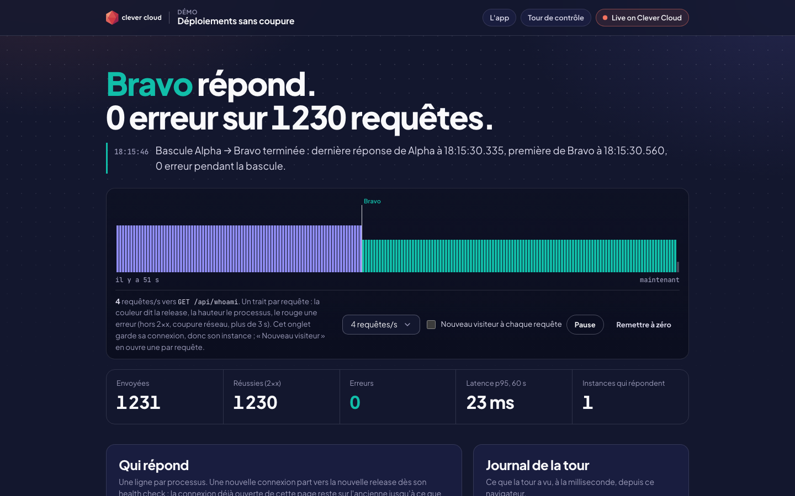
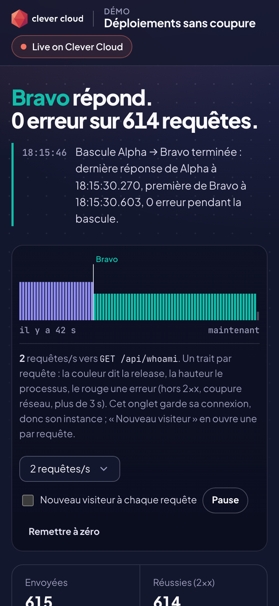
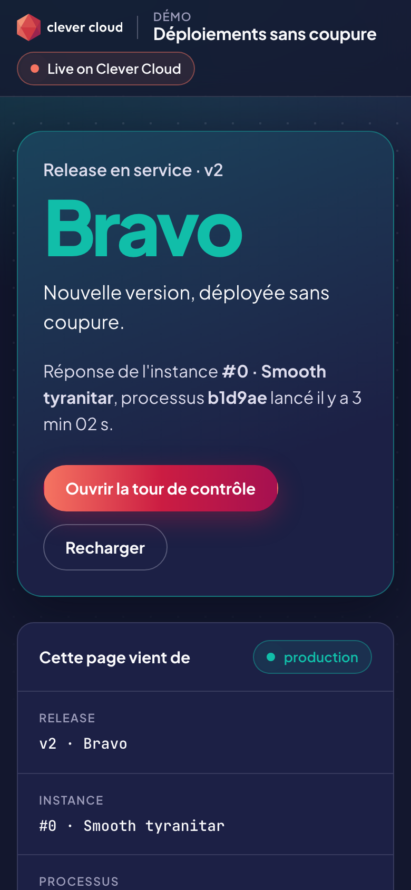
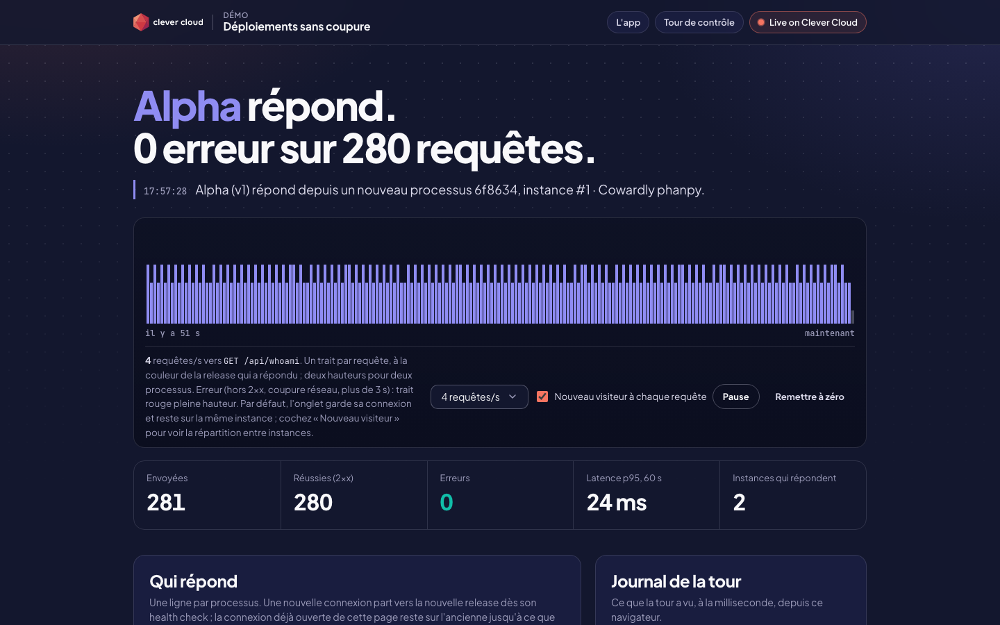

# Control Tower — Zero-downtime deployments on Clever Cloud

> Before moving to a PaaS, every enterprise team asks two questions: does a deployment cut the service, and what happens when the new version is broken? This demo answers with measurements. A small Go app says which release answered (Alpha, Bravo or Charlie, each with its own color), from which instance and which process. Its **control tower** sends a few requests per second from the browser and counts every success and every error while you deploy, push a broken release, roll back to a commit and scale out. Every figure below was measured on Clever Cloud on 4 November 2026. Nothing is assumed.




| Phone, the tower | Phone, the app |
|---|---|
|  |  |

**Run it yourself.** A live copy runs at <https://app-9880cd24-e28b-4a94-942c-296b6f483ee0.cleverapps.io/tower> (redeployed on 2026-11-10; it may be stopped between demos). The steps in [Deploy on Clever Cloud](#deploy-on-clever-cloud) recreate it in about 3 minutes. Playing the four scenes takes about 30 minutes, 17 of them spent watching Clever Cloud reject the broken release.

**Get certified.** This demo runs on Clever Cloud. To deploy your own apps the same way, get certified at the [Clever Cloud Academy](https://academy.clever.cloud/).

## What Clever Cloud does here

| Scene | Command | What Clever Cloud did (measured) | Errors seen |
|---|---|---|---|
| 1. Deploy | `clever deploy` | Built the commit on the dedicated build instance (`go install`: 9 s), started a new instance next to the old one, called `/health`, then switched the traffic. 44 s from the command to the end of `clever deploy` (42 to 53 s for 8 of the session's 9 deployments; one took 76 s, 17 s of them before the push began). | 0 |
| 2. Deploy a broken release | `clever deploy` (Charlie: `/health` answers 503) | Called `/health` 10 times, doubling the delay each time (2 s, 4 s, 8 s… 512 s), sent no request to Charlie, then marked the deployment **FAIL after 17 min 7 s**. Bravo served all along. (In our run `clever deploy` stayed stuck before starting, see below; `clever restart --commit` on Charlie's commit started it.) | 0 on the probes; 2 of the rare 502s on the desktop tower |
| 3. Roll back to a commit | `clever restart --commit <Alpha's commit>` | Reused that commit's build from the cache, with no compilation: `/health` answered 200 15 s after the command. New connections reached Alpha 6 to 7 s later; open ones 2 min later. | 0 on the probes; 1 rare 502 on the desktop tower |
| 4. Scale out | `clever scale --instances 2` | An **UPSCALE operation**: two new instances started from the build cache (health checks 200 14 s and 17 s after the command), took the new connections, and the old instance stopped 2 min later. With two instances, new connections were spread evenly: 344 and 347 requests from 16:57 to 17:09 UTC. | 0 |
| Back to the range | `clever scale --min-instances 1 --max-instances 2` | Nothing at once. The autoscaler removed the second instance 9 min 56 s later (operation DOWNSCALE, by *Monitoring/Scaling*). | 0 |

The probes saw **0 errors in the whole session**: 11,217 requests on a kept connection, 5,160 on new connections. The rare 502s, seen by the desktop tower only, are described in [Rare 502s outside the switch-overs](#rare-502s-outside-the-switch-overs). They hit the instance that was already serving, and only one fell inside a switch-over (scene 3).



### The switch-over, request by request

There are two moments, and a demo should show both:

- **New connections** (a new visitor, a private window, `curl`) reach the new release within seconds of its health check.
- **Connections already open** (the tab you demo from, an HTTP client with keep-alive) stay on the old instance. They move when Clever Cloud stops that instance, **2 minutes after the new one passed its health check**, with no error. This matches the doc: the old instance is *"turned off minutes later"* ([blue/green on Clever Cloud](https://www.clever.cloud/developers/doc/develop/best-practices/blue-green/)).

Measured with two probes running from a laptop in Paris (`probe/probe.go`): one keeps its connection open at 2 requests per second, the other opens a new connection for every request at 1 per second. The switch happened between the two requests shown. Times are UTC; offsets are counted from the `Response from GET /health is 200` line.

| Deployment | Health check 200 | New connections: last old → first new | Open connection: last old → first new |
|---|---|---|---|
| `clever deploy`, Alpha → Bravo | 15:45:09.819 | probe not started yet | +120.2 s → +120.7 s |
| `clever deploy`, Bravo → Alpha | 15:52:08.288 | +0.5 s → +1.5 s | +120.2 s → +120.7 s |
| `clever deploy`, Alpha → Alpha | 15:56:14.099 | +0.7 s → +1.7 s | +119.9 s → +120.4 s |
| `clever deploy`, Alpha → Bravo (scene 1) | 15:59:24.899 | −0.1 s → +0.9 s | +120.6 s → +121.1 s |
| `clever restart --commit`, Bravo → Alpha (scene 3) | 16:34:12.999 | +5.8 s → +6.8 s | +120.5 s → +121.0 s |
| `clever deploy`, Alpha → Alpha | 16:40:10.976 | +1.8 s → +2.8 s | +121.0 s → +121.5 s |
| `clever scale --instances 2` (scene 4), 1 → 2 new instances | 16:52:27.629 (the second one) | +1.2 s → +2.2 s | +120.4 s → +120.9 s |
| `clever deploy` with 2 instances | 16:57:05.340 | +3.4 s → +4.4 s | +120.6 s → +121.1 s |
| `clever deploy`, Alpha → Alpha | 17:10:33.774 | +1.0 s → +2.0 s | +120.2 s → +120.7 s |
| `clever deploy`, Alpha → Bravo (the screenshot above) | 17:13:30.019 | +1.7 s → +2.7 s | +119.9 s → +120.4 s |

Traffic during the whole session (15:42 to 17:16 UTC), light on purpose: the two probes, plus two browser towers (desktop at 4 requests per second, phone at 2, each on a kept connection). All four spoke HTTP/2 with the load balancer. In all, about 9 requests per second.

### Rare 502s outside the switch-overs

Over the session, the clients counted 50,287 requests. The Clever Cloud access logs (`clever accesslogs`, a beta feature) list 44,585 of them: 44,579 answered 200, 6 answered **502**. The two probes and the phone tower saw none. The desktop tower (22,327 requests) saw all six.

What the six have in common:

- The load balancer answered in 0 to 3 ms, with no service time: the request never reached the app.
- They all hit the same instance, Bravo, the one that lived longest (15:59 to 16:36 UTC). The first came 6.5 minutes after it started.
- They all fell at :00 or :30 past the minute (16:06:00, 16:08:00, 16:12:30, 16:22:30, 16:27:00, 16:35:00), at about +0.35 s. The desktop tower sends a request at that point of the second; the other clients send at other points, which may be why they saw none.
- At 16:35:00, during scene 3, the desktop tower's connection left the old instance on that very request: its next request reached Alpha, 47 s after Alpha's health check.

What we changed, and what followed. The app closed idle connections after 60 s (Go's `IdleTimeout`), sooner than the 180 s the doc gives for Sōzu's backend operations ([troubleshooting](https://www.clever.cloud/developers/doc/find-help/troubleshooting/)). From 16:40 we deployed with 10 minutes. Afterwards: 0 × 502 out of 17,127 requests over 36 minutes, on seven instances that lived up to 15.5 minutes each. The desktop tower still changed instance twice exactly at :00 (16:57:00.36 and 16:58:00.36), without an error. Six events are too few to call this a proof. The 10-minute setting stays as a precaution: an app should not close an idle connection before the load balancer does.

### What the autoscaler did

Range nano → XS and 1 → 2 instances, light load (about 9 requests per second) from 15:43 UTC. The status was read every minute from 16:40 to 17:16, and at 16:13 and 16:26 before that.

- **Up:** the autoscaler never scaled up. The app stayed at 1 × nano for 69 minutes, until we asked for 2 instances at 16:52.
- **Down:** after `clever scale --min-instances 1 --max-instances 2` at 16:59:03, it removed the second instance at 17:08:59 (operation DOWNSCALE, by *Monitoring/Scaling*), with 0 errors. The connections on that instance moved to the other one.
- **What the doc says triggers it:** *"In case of large traffic, we detect a high load"*, with no threshold. Vertical scaling comes first ([scaling](https://www.clever.cloud/developers/doc/develop/common-configuration/scaling/)): with this range, Clever Cloud would move to XS before adding an instance.
- **Not observed:** any automatic scale-up, vertical or horizontal. Loading the CPU enough to trigger one was out of scope: this demo stays at a light load.

### Good to know before a live demo

- After *Successfully deployed*, the tab you demo from still shows the old release for 2 minutes (its connection is still open). To show the new release at once, open the app in a private window.
- `clever deploy` returns before printing the health check lines. Read them with `clever logs --since 5m --until now`.
- The broken release takes 17 minutes to be marked FAIL. Start scene 2 early, show scene 3 or 4 while Clever Cloud insists, and come back to it.
- `clever scale --instances 2` replaces the running instance with two new ones: the tab changes instance 2 minutes later. A tab keeps one connection, so it stays on one instance; check « Nouveau visiteur » in the tower to see the traffic spread over both.
- Once, `clever deploy` stayed on *Waiting for deployment to start* for 10 minutes: the code was pushed, but no deployment was created (`clever activity` showed none). `clever restart --commit <the commit you pushed>` started it in under a second.
- The app writes a line when it receives SIGTERM. No such line, and no platform line, reached `clever logs` when Clever Cloud stopped the old instances. The probes are what tell you when that happened.

## Deploy on Clever Cloud

You need [clever-tools](https://www.clever.cloud/developers/doc/cli/) (`clever login` done) and the ID of the organisation that will own the app (`orga_…`, shown in the Console). Run the commands from the repo root: `clever create` links the folder to the new app.

```bash
# 1. The app and its size: nano to XS, 1 to 2 instances, dedicated build M
clever create --type go demo-zero-downtime --org <org_id> --region par
clever scale --min-flavor nano --max-flavor XS --min-instances 1 --max-instances 2
clever scale --build-flavor M

# 2. Variables
clever env set CC_GO_BUILD_TOOL gomod          # build the module from go.mod
clever env set CC_HEALTH_CHECK_PATH /health    # Clever Cloud switches traffic only once /health answers 2xx

# 3. Deploy release v1 Alpha
clever deploy
clever domain                                  # then open https://<domain>/tower
```

No add-on, no setup script. Then play the scenes with the tower open:

```bash
# Scene 1: deploy without downtime
cp releases/v2-bravo.json release.json && git commit -am "Release v2 Bravo" && clever deploy

# Scene 2: a broken release, rejected by the health check
cp releases/v3-charlie-broken.json release.json && git commit -am "Release v3 Charlie" && clever deploy

# Scene 3: back to Alpha by its commit (the tower's "Qui répond" table has a "copier" button)
clever restart --commit <alpha-commit-sha>

# Scene 4: two instances, then back to the 1–2 range
# First make sure the app may run 2 instances: if it is limited to 1, the next command cannot add the second one
clever scale --min-instances 1 --max-instances 2 --alias demo-zero-downtime
clever scale --instances 2
clever scale --min-instances 1 --max-instances 2
```

To measure from a terminal as well (light load, as in this README):

```bash
go run probe/probe.go -url https://<domain> -rps 2 -out kept.csv           # keeps its connection, like a browser tab
go run probe/probe.go -url https://<domain> -rps 1 -fresh -out fresh.csv   # a new connection per request, like a new visitor
```

The probe prints a line when a new process answers, when one stops answering, and for every error; Ctrl-C prints the summary.

## Variables

| Variable | Set by | Role |
|---|---|---|
| `CC_GO_BUILD_TOOL` | you | `gomod`: build the module declared in `go.mod` |
| `CC_HEALTH_CHECK_PATH` | you | `/health`: the deployment succeeds only if it answers 2xx; Charlie makes it answer 503 |
| `PORT` | Clever Cloud | Listen port, `8080` when unset |

The release is not a variable: it is the file `release.json`, compiled into the binary with `embed`. Each commit carries exactly one release, so a rollback to a commit brings its release back.

The pages and `/api/whoami` show `CC_APP_NAME`, `APP_ID` (for the *Live on Clever Cloud* pill), `INSTANCE_NUMBER`, `INSTANCE_TYPE`, `CC_PRETTY_INSTANCE_NAME`, `COMMIT_ID`/`CC_COMMIT_ID` and `CC_DEPLOYMENT_ID`, and nothing else. After `clever restart --commit`, `COMMIT_ID` held the restarted commit. Go also stamps the commit into the binary (`vcs.revision`), returned as `built_from`.

## Routes

`GET /` the app, in the color of its release · `GET /tower` the control tower (`?rate=1|2|4|8`, `?fresh=1` for « Nouveau visiteur ») · `GET /api/whoami` who answered (release, instance, process, commit, deployment; `Cache-Control: no-store`; with `?fresh=1` the app answers `Connection: close`, so the load balancer picks an instance again for the next request) · `GET /health` 200, or 503 for a release with `"health": "fail"` (each call is logged, so the deployment logs show every attempt) · `GET /cc-brand.css`, `/app.css`, `/tower.js`. Other verbs → 405, other paths → 404, security headers everywhere (strict CSP, no inline script).

## Code tour

```
main.go               HTTP server (timeouts, SIGTERM drain), routes, /api/whoami (?fresh=1), /health
release.go            the release compiled into the binary: version, name, color, health
platform.go           the variables Clever Cloud injects, the process id, the build commit
release.json          the release this commit deploys (a copy of one file in releases/)
releases/             v1-alpha.json, v2-bravo.json, v3-charlie-broken.json
static/tower.html     the control tower: ribbon, counters, who answers, log, the four scenes
static/tower.js       sends the requests, detects switch-overs and errors, draws the ribbon
static/index.html     the app page; brand.tmpl holds the Clever Brand Kit frame
static/cc-brand.css   Clever Brand Kit, copied as is
probe/probe.go        the same tower for the terminal, one CSV line per request (go run)
main_test.go          httptest tests: release files, /health per release, whoami, ?fresh=1, pages, routes
```

Go standard library only; `static/` is embedded, so the binary is self-contained.

## Run locally

```bash
go run .                                    # http://localhost:8080 and /tower
PORT=8131 go run .
gofmt -l . ; go vet ./... && go test -race ./...
```

Requires Go 1.27+. Locally the pages say « injecté au déploiement » where Clever Cloud variables would be.

## License

[MIT](LICENSE) © 2026 [Vitiosum](https://github.com/Vitiosum)
